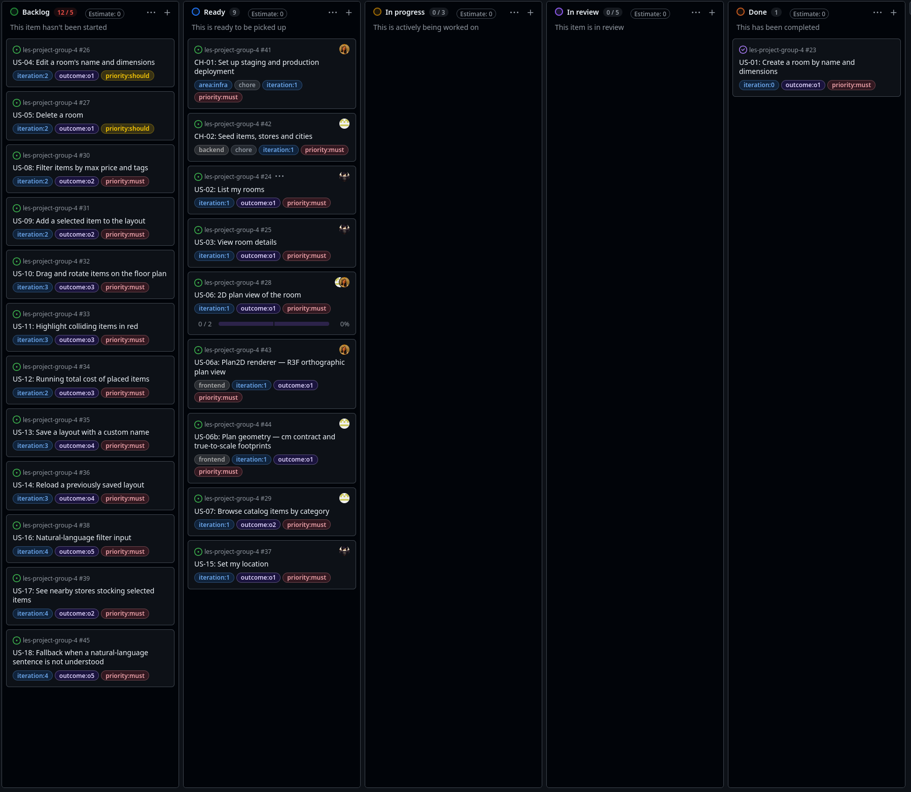
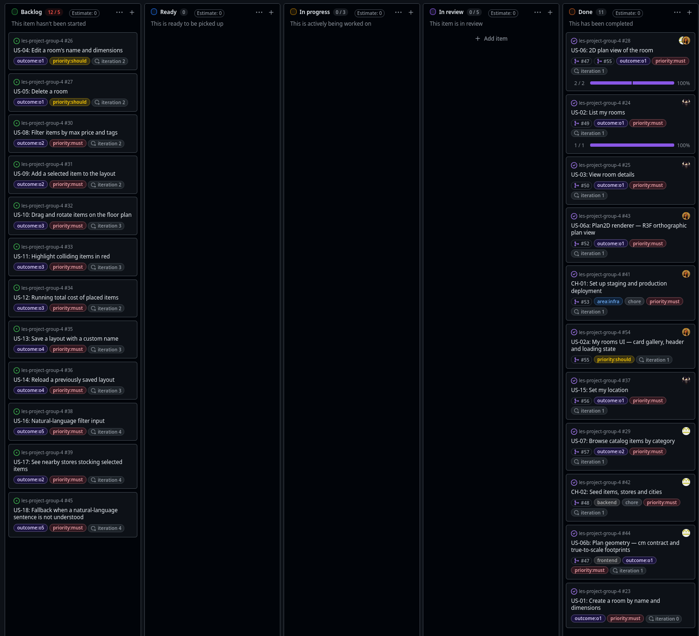

# CLAIM - Iteration 1

> FurniMi · LES – Team D · FEUP 2026/27

This is the entry point for Iteration 1 (23 Oct – 6 Nov 2026). The
iteration completes O1, starts O2, and ships the 2D plan setup so the
visualiser is de-risked early.

## Documents in this iteration

The scope and process contracts still live in the Iteration 0 folder
until this iteration's documents are added:

| Document                      | What it answers                                                  |
| ----------------------------- | ---------------------------------------------------------------- |
| [mvp.md](../0/mvp.md)         | The scope contract: MVP outcomes O1–O5 and what is out of scope. |
| [stories.md](../0/stories.md) | The backlog and the public cut.                                  |
| [DoD.md](../0/DoD.md)         | The shared bar for "done", per change and per iteration.         |

Iteration-specific documents still to add: `retro.md`, `ai-log.md`, and
`ci.md` if the pipeline changes.

## Board

Screenshots are taken from the same GitHub Project view (grouped by **Status**) at the start and end of the
iteration.

| Before the iteration                          | After the iteration                         |
| --------------------------------------------- | ------------------------------------------- |
|  |  |

## Permalinks

- Production: TBD
- Staging: TBD
- Tag: TBD
- Compare with previous tag: [`iter-0...iter-1`](https://github.com/MESW-LES-2627/les-project-group-4/compare/iter-0...iter-1) (once `iter-1` exists)
