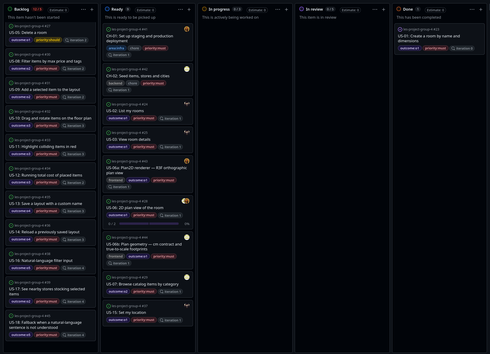
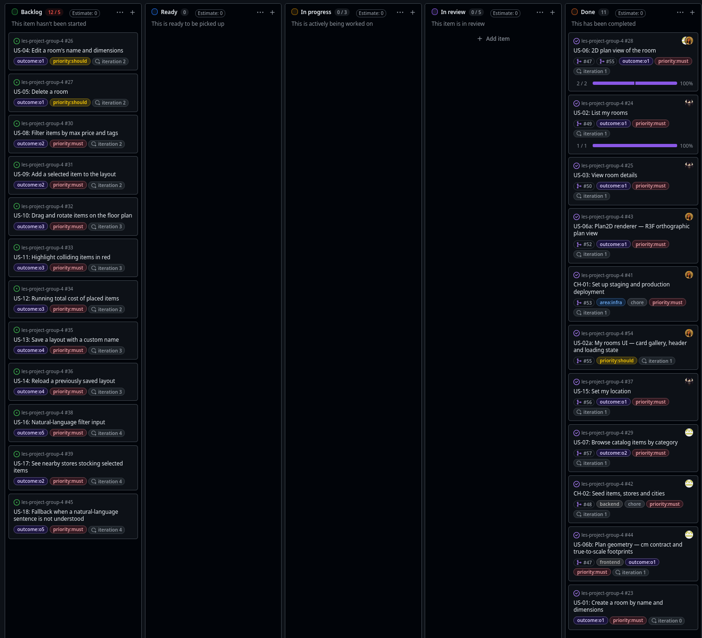

# Board - before vs after Iteration 1

> FurniMi · LES - Team D · FEUP 2026/27

Two snapshots of the Iteration 1 project board: [before.png](board/before.png)
(before work started, added to the repo on 27 Oct) and
[after.png](board/after.png) (iteration closeout, 6 Nov).

| Before                                                  | After                                                 |
| :-----------------------------------------------------: | :---------------------------------------------------: |
|                |                 |

## Column totals

| Column      | Before | After  | Change                                       |
| ----------- | :----: | :----: | -------------------------------------------- |
| Backlog     |   12   |   12   | No change                                    |
| Ready       |   9    |   0    | All 9 iteration-1 items moved out            |
| In progress |   0    |   0    | -                                            |
| In review   |   0    |   0    | -                                            |
| Done        |   1    |   11   | +10: the 9 planned items, plus new issue #54 |
| **Total**   | **22** | **23** | **+1 (only #54 was added)**                  |

## What changed

- **Every planned Iteration 1 issue was completed.** The nine cards in
  `Ready` (#24, #25, #28, #29, #37, #41, #42, #43, #44) are all in
  `Done` after the iteration, each with its pull request linked.
- **One new issue was added: #54.** It did not exist on the before
  board and is the only reason the total count went from 22 to 23.
- **US-01 (#23) stayed in `Done`** where it already was.
- **The backlog did not change.** The counter stays at 12 in both
  snapshots, and the only card visible after but not before is US-04
  (#26), which is cut off above the fold in the before screenshot
  because the column is scrolled. The rest of the backlog is for
  Iterations 2-4.

## New issues added

| Issue | Title                                                        | Labels                           | Iteration | Closed by |
| ----- | ------------------------------------------------------------ | -------------------------------- | --------- | --------- |
| #54   | US-02a: My rooms UI - card gallery, header and loading state | `priority:should`, `iteration 1` | 1         | PR #55    |

It is the sub-issue added under US-02 (#24): #24 has no sub-issue bar
on the before board and shows **1/1, 100%** after. It is also the only
Iteration 1 card labelled `priority:should`; the rest were
`priority:must`.

Note that PR #55 targeted `develop`, and `main` is the default branch,
so merging it did not close #54 automatically; the card reached `Done`
because someone closed the issue by hand before the after snapshot (see
[retro.md](retro.md)).

## Planned issues that moved from Ready to Done

| Issue | Title                                                            | Linked PR |
| ----- | ---------------------------------------------------------------- | --------- |
| #24   | US-02: List my rooms                                             | #49       |
| #25   | US-03: View room details                                         | #50       |
| #28   | US-06: 2D plan view of the room                                  | #47, #55  |
| #29   | US-07: Browse catalog items by category                          | #57       |
| #37   | US-15: Set my location                                           | #56       |
| #41   | CH-01: Set up staging and production deployment                  | #53       |
| #42   | CH-02: Seed items, stores and cities                             | #48       |
| #43   | US-06a: Plan2D renderer - R3F orthographic plan view             | #52       |
| #44   | US-06b: Plan geometry - cm contract and true-to-scale footprints | #47       |

## Smaller differences

- **Sub-issue progress.** #28 (US-06) went from **0/2, 0%** to
  **2/2, 100%** once #43 and #44 were done. #24 (US-02) gained the
  **1/1, 100%** bar because of #54.
- **Label change.** #43 no longer shows the `frontend` label in the
  after snapshot; #44 still does.
- **Empty middle columns.** `In progress` and `In review` are empty in
  both snapshots. The snapshots were taken at the start and at the
  close, so they do not show the work flowing through those columns.
  The retro notes that most PRs landed in the last three days and were
  reviewed in parallel with the release PR (#58), which these two
  boundary snapshots cannot show.
