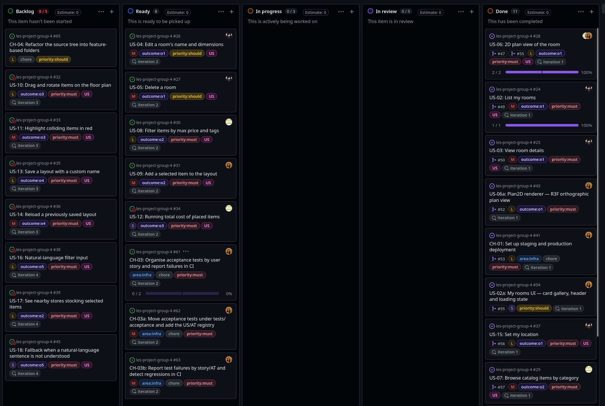
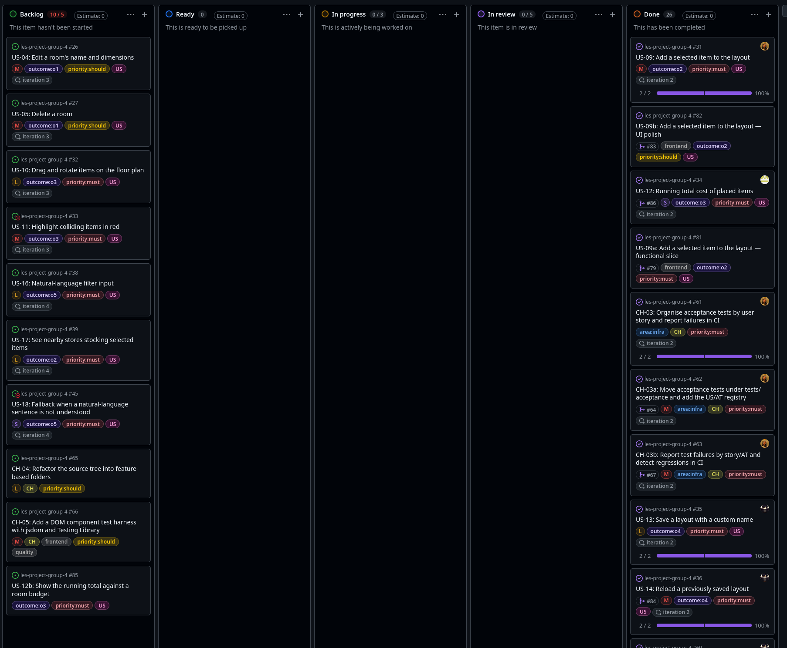

# Board - before vs after Iteration 2

> FurniMi · LES - Team D · FEUP 2026/27

Two snapshots of the Iteration 2 project board: [before.png](board/before.png)
(taken on 10 Nov, four days into the iteration) and [after.png](board/after.png)
(iteration closeout, 20 Nov).

| Before                                                  | After                                                 |
| :-----------------------------------------------------: | :---------------------------------------------------: |
|                |                 |

## Column totals

| Column      | Before | After  | Change |
| ----------- | :----: | :----: | ------ |
| Backlog     |   8    |   10   | +2     |
| Ready       |   8    |   0    | -8     |
| In progress |   0    |   0    | -      |
| In review   |   0    |   0    | -      |
| Done        |   11   |   26   | +15    |
| **Total**   | **27** | **36** | **+9** |

The after board has nine more cards than the before board: #66, #69–#72, #78,
#81, #82 and #85. All Iteration 2 issue cards are in `Done`, and `Ready` is
empty. The two Should cards (#26, #27) moved to `Backlog` for Iteration 3, and
#66 and #85 were added there; the other backlog cards did not change.

## What moved from Ready to Done

| Issue | Title | Linked PR(s) |
| ----- | ----- | ------------ |
| #30 | US-08: Filter items by max price and tags | #77 |
| #31 | US-09: Add a selected item to the layout | #79 (US-09a), #83 (US-09b) |
| #34 | US-12: Running total cost of placed items | #86 |
| #61 | CH-03: Organise acceptance tests by user story and report failures in CI | #64, #67 |
| #62 | CH-03a: Move acceptance tests under `tests/acceptance` and add the US/AT registry | #64 |
| #63 | CH-03b: Report test failures by story/AT and detect regressions in CI | #67 |

All six Ready cards that belonged to Iteration 2 moved to `Done`. #31 closes
through #82/#83; #34 through #86. The two Should cards (#26 US-04,
#27 US-05) moved from `Ready` to `Backlog` and are labeled Iteration 3.

## What was pulled forward from the backlog

| Issue | Title | Linked PR(s) |
| ----- | ----- | ------------ |
| #35 | US-13: Save a layout with a custom name | #73, #74 |
| #36 | US-14: Reload a previously saved layout | #73, #75, #84 |

US-13 and US-14 were planned for Iteration 3. They finished in Iteration 2, so
the parent stories closed early and O4 is complete.

## New issues added during the iteration

| Issue | Title | Created | State after iteration |
| ----- | ----- | ------- | --------------------- |
| #66 | CH-05: Add a DOM component test harness with jsdom and Testing Library | 11 Nov | Open, not in the Iteration 2 milestone |
| #69 | US-13a: Layouts API — save a layout | 12 Nov | Closed (#73) |
| #70 | US-13b: Save layout form on the room page | 12 Nov | Closed (#74) |
| #71 | US-14a: Layouts API — list, open and delete | 12 Nov | Closed (#73) |
| #72 | US-14b: Saved layouts list and reload on the room page | 12 Nov | Closed (#75, #84) |
| #78 | Chore: upgrade Next.js 16.4.2 → 16.4.6 (security) | 17 Nov | Closed (#80) |
| #81 | US-09a: Add a selected item to the layout — functional slice | 18 Nov | Closed (#79) |
| #82 | US-09b: Add a selected item to the layout — UI polish | 18 Nov | Closed (#83) |
| #85 | US-12b: Show the running total against a room budget | 19 Nov | Open, Iteration 3 |

#61, #62, #63 and #65 were created on 10 Nov and are already visible on the
before board, so they are not in this table. #77, #79, #83, #84 and #86 are
pull requests, not issues; #76 has no issue of its own.

## What did not move to Done

| Issue | Title | Why |
| ----- | ----- | --- |
| #26 | US-04: Edit a room's name and dimensions | Should; cut from Iteration 2, moved to Iteration 3 |
| #27 | US-05: Delete a room | Should; cut from Iteration 2, moved to Iteration 3 |
| #32 | US-10: Drag and rotate items on the floor plan | Iteration 3 |
| #33 | US-11: Highlight colliding items in red | Iteration 3 |
| #38 | US-16: Natural-language filter input | Iteration 4 |
| #39 | US-17: See nearby stores stocking selected items | Iteration 4 |
| #45 | US-18: Fallback when a natural-language sentence is not understood | Iteration 4 |
| #65 | CH-04: Refactor the source tree into feature-based folders | Backlog, not committed |
| #85 | US-12b: Running total against a room budget | Moved out of US-12 into Iteration 3 |

## Smaller differences

- **Sub-issue progress.** #31 (US-09) goes from **0/2, 0%** to **2/2, 100%**
  once #81 and #82 are done. #61 (CH-03) goes from **0/2, 0%** to
  **2/2, 100%** once #62 and #63 are done.
- **#34 has no sub-issue bar.** The budget was moved to a separate story (#85),
  not made a sub-issue, so US-12 stays a single card.
- **The milestone is complete.** #83 closed #82 and #86 closed #34, so every
  Iteration 2 issue is closed. GitHub still counts the open release PR #88 in
  the milestone, so its open counter is not zero until that PR merges; no story
  is open.
- **Boundary snapshots.** The before snapshot was taken on 10 Nov, not on
  6 Nov, so it shows CH-03 already in `Ready`. As in Iteration 1, the two
  boundary snapshots do not show the work flowing through `In progress` and
  `In review`; the retro covers that.
